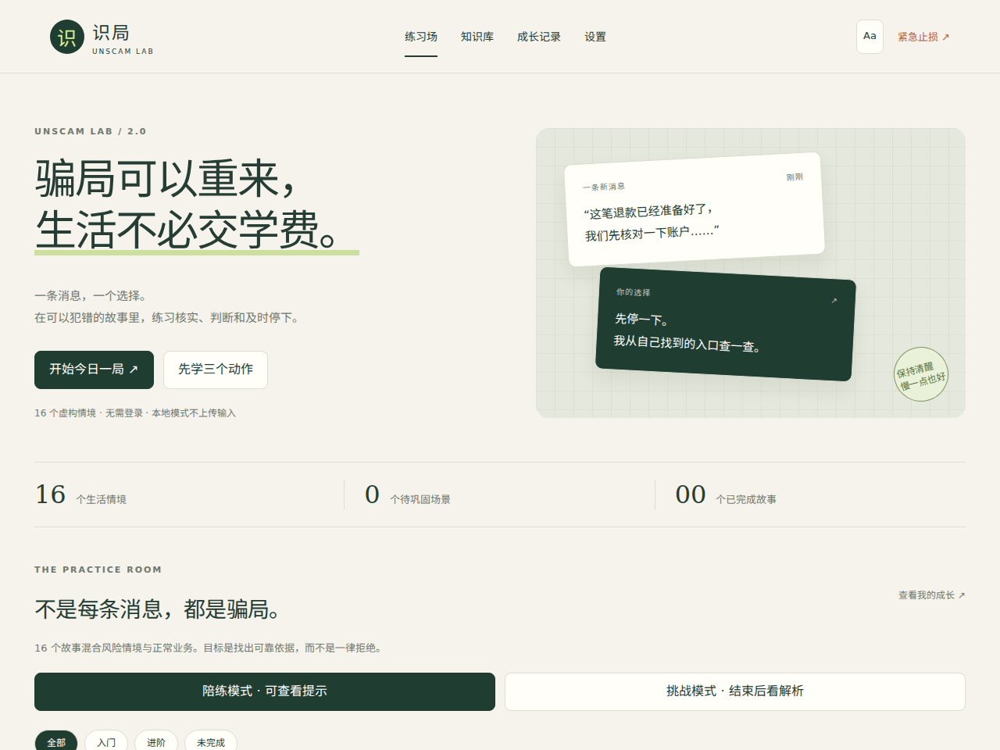
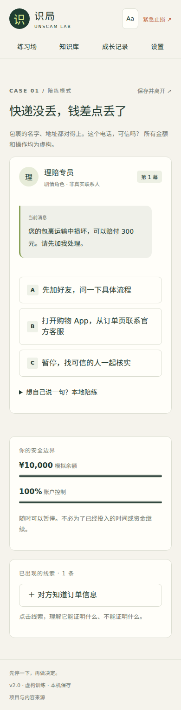

# 识局 · Unscam Lab 2.0

**骗局可以重来，生活不必交学费。**

一个可以自己部署的中文防骗互动学习应用。在虚构对话里观察线索、自由追问、作出选择，再用复盘和间隔复习把判断练熟。无需账号，基础模式不上传学习输入。



> 本版本包含完整的本地学习流程与可选 AI 服务，适合个人、家庭与小规模自托管使用。程序代码 MIT；教育文本及参考知识采用 CC BY-NC-SA 4.0，不能把整包内容直接用于商业用途。

## 2.0 更新了什么

| 能力 | 当前实现 |
| --- | --- |
| 生活情境 | 16 个故事：12 个风险情境 + 4 个正常业务对照。核实后可以继续正常业务，避免把“全拒绝”当成识骗。 |
| 分支探索 | 核验、追问、继续、暂停、止损等动作；5 类结局；每个故事展示已探索的结局。 |
| 两种模式 | 陪练模式可看线索解释；挑战模式隐藏首页情境标签、延迟解析并打乱选项顺序。 |
| 逐步线索 | 只展示当前剧情已经出现的线索；保留完整的剧情消息与行动记录。 |
| 教学复盘 | 路径、资金与账户影响、机制解释、迁移判断题、打印和 JSON 导出。 |
| 个性化回练 | 风险结局或迁移题首答错误自动加入回练；知识卡使用 1 / 3 / 7 / 14 / 30 天间隔。 |
| 知识内容 | 6 张有官方来源的行动卡；373 篇带出处的上游参考摘录，可搜索、分类和收藏。 |
| AI 对话 | 最近 6 条对话上下文、自然语言意图建议、动态追问按钮。玩家确认后才执行已编写的行动。 |
| 多端 | 桌面、平板、手机响应式页面，大字模式、键盘导航、减少动画、PWA 安装与离线基础玩法。 |
| 数据 | 自动续玩、结束后刷新保留复盘、v1 记录迁移、严格校验备份、合并保留较高成绩。 |
| 运维 | 健康检查、请求上限与超时、公开服务口令、按日请求预算、Docker、CI、静态构建与可选 Pages 工作流。 |

详细变化见 [CHANGELOG.md](CHANGELOG.md)。

## 五分钟开始

要求 **Node.js 22 或更新版本**。生产运行不需要安装第三方依赖。

```bash
git clone https://github.com/xiaohuan-M/unscam-lab.git
cd unscam-lab
cp .env.example .env
npm start
```

打开 **http://127.0.0.1:3000**。没有 API Key 也能完成所有故事、复盘、搜索与复习。

推荐先点“先学三个动作”，再体验“快递没丢，钱差点丢了”。从陪练切换到挑战时，试着把“我觉得像骗局”说清楚为“我能核实哪条证据”。



## 接入 LLM

1. 在 `.env` 中配置服务与模型，重启应用：

```dotenv
LLM_BASE_URL=https://你的服务商/v1
LLM_MODEL=你的模型名
LLM_API_KEY=你的密钥
```

2. 进入“设置”，查看实际服务商和模型。
3. 可先“测试连接”（会调用一次模型，可能计费），再勾选启用 AI 并保存。
4. 进入故事，展开“想自己说一句”，自由追问。

协议为 **OpenAI 兼容 `POST /chat/completions`**，服务须支持 `messages`、`max_tokens`、`temperature` 并能返回符合提示的 JSON。基础地址不包含 `/chat/completions`。本机模型可配置 `http://localhost:11434/v1` 等地址；非本机地址要求 HTTPS。兼容协议不代表每个模型都已实测。

如果不想把 Key 写在服务器，可留空 `LLM_API_KEY`，在设置页填临时 Key。Key、访问口令和 AI 开关仅存在当前页面内存中，刷新即清空；不会进入 localStorage 或导出备份。服务端配置的 Key 优先。

### AI 能做什么，不能做什么

- 能结合当前情境与最近 6 条对话回应，并提供新的核实性追问。
- 能把用户“我想回原 App 核实”等意图匹配到当前合法行动，玩家确认后执行。
- **不会自动扣款、改变分数或创建未经编写的新结局。** 这是有边界的互动剧情，并非无限生成世界。
- 模型失败、返回无效 JSON、超时或达到额度时，已有剧情仍能继续。
- 开启 AI 后，当前场景、最近对话和输入会发送到配置的服务商。请只讨论虚构情境，不输入真实账号、身份证、验证码等信息。

真实第三方付费模型需要部署者用自己的凭据验收；仓库测试使用模拟响应和本地 HTTP 兼容服务，不声称已经实测所有提供商。

## 部署方式

| 方式 | 基础玩法 | AI 对话 | 适用场景 |
| --- | --- | --- | --- |
| `npm start` | 是 | 可选 | 本机或服务器 |
| Docker | 是 | 可选 | 自托管服务器 |
| `npm run build` → `dist/` | 是 | 否 | 静态站点、GitHub Pages |

### 静态版

```bash
npm run build
```

将 **`dist/` 内全部文件**部署到静态站点。支持仓库子路径，无需打包器。静态版自动使用本地陪练。不能直接双击 `index.html` 使用，需要 HTTP(S) 服务。

仓库提供手动触发的 [Deploy static site](.github/workflows/pages.yml) 工作流。首次使用时，在仓库 Settings → Pages 将 Source 设为 GitHub Actions，再手动运行。此工作流会公开静态网站；推送代码不会自动发布站点。

### Docker / 公开 AI 服务

```bash
docker build -t unscam-lab:2.0.0 .
docker run --rm --name unscam-lab \
  -p 127.0.0.1:3000:3000 \
  --env-file .env -e HOST=0.0.0.0 -e APP_MODE=public \
  unscam-lab:2.0.0
```

通过 HTTPS 反向代理转发到该端口，并配置：

```dotenv
APP_MODE=public
APP_TOKEN=替换为至少16字符的随机口令
PUBLIC_ORIGIN=https://你的实际域名
LLM_DAILY_LIMIT=200
```

`APP_TOKEN` 只限制 AI 接口，基础页面仍可访问。即使后端绑定 localhost，只要通过反向代理公开，也必须设置 `APP_MODE=public`。公开模式没有合格口令时，AI 被禁用。

自带限制：每来源连接 IP 每分钟 20 次、同时最多 3 次模型调用、默认每服务器进程每 UTC 日 200 次。失败的提供商调用同样占预算。重启会重置内存计数，反向代理后的多个用户可能共用一个 IP；这些措施适合小规模实例，不能替代多实例计费与账号配额。更多说明见 [部署文档](docs/DEPLOYMENT.md)。

## 离线、升级与学习记录

- HTTPS 或 localhost 首次完整加载后，基础资源被缓存；断网可以重新打开并完成故事。
- 发布更新后页面提示“新版已就绪”，点击更新会保存进度并加载新资源。
- `npm run build` 根据资源内容生成缓存版本，不需要手工修改版本号。
- 记录只保存在当前浏览器。跨设备使用“导出备份 / 导入备份”。
- v1 记录会自动迁移；备份导入不会降低既有最高分，也不会导入密钥或聊天。
- iOS 可通过 Safari 的分享菜单添加到主屏幕；实际安装行为依浏览器而异。

## 开发与验证

```bash
npm ci
npx playwright install chromium
npm run verify
```

`verify` 包含语法与剧情图校验、Node 测试、静态构建和 Chromium 浏览器测试。CI 另在 Node 22 / 24 上运行核心检查，并上传静态部署包和浏览器测试记录。

本版验收包含全部编写路径、余额和止损规则、正常情境、刷新续玩、错误备份、迁移判断、搜索复习、AI 上下文与失败恢复、离线完整故事，以及 320 / 390 / 768 / 1440 像素布局。详见 [QA.md](docs/QA.md)。移动端验收为 Chromium 窗口模拟，尚不等于 iOS / Android 真机验收。

```text
public/app.js              页面与交互
public/engine.js           可重放的确定性剧情引擎
public/lib/storage.js      迁移、校验、合并与备份
public/data/scenarios.json 剧情节点、线索、结局与迁移题
public/data/lessons.json   行动卡与公开来源
public/data/knowledge.json 上游参考摘录
server/llm.mjs             上下文、输出校验、合法行动映射
server/index.mjs           HTTP 服务、模型代理、访问和预算控制
scripts/build.mjs          静态产物与离线缓存版本
tests/                     单元、接口与浏览器测试
```

## 来源、许可与贡献

参考 [QERSSD/HowToAvoidScams](https://github.com/QERSSD/HowToAvoidScams)，不是其官方版本。保留上游 373 篇摘录及署名；未声称全部独立核验。六张行动卡另附公开来源与核对日期。故事均为虚构，不是实际案件还原；练习分不代表真实防骗能力。

- 程序代码：MIT。
- 教育文本与知识摘录：CC BY-NC-SA 4.0。商业使用需取得授权或独立替换受限材料。
- [内容来源与编写规范](docs/CONTENT.md) · [贡献指南](CONTRIBUTING.md) · [隐私说明](docs/PRIVACY.md) · [安全边界](SECURITY.md)

当前不包含用户账号、云端同步、原生客户端、语音通话或未经审核的无限生成剧情。这些不影响本版本的完整基础学习流程。
