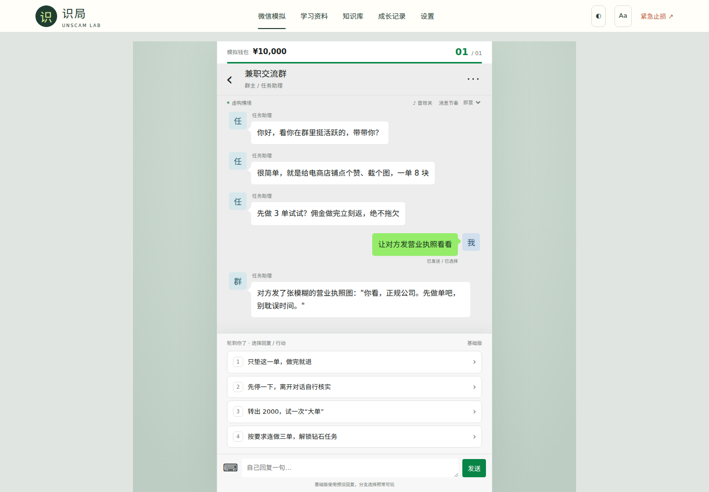
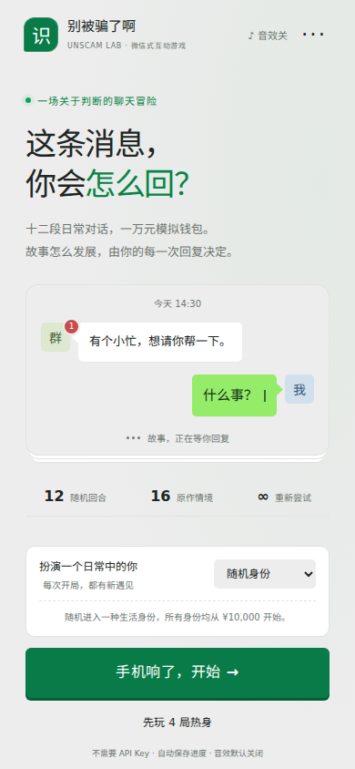
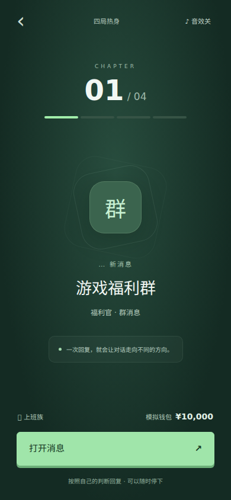
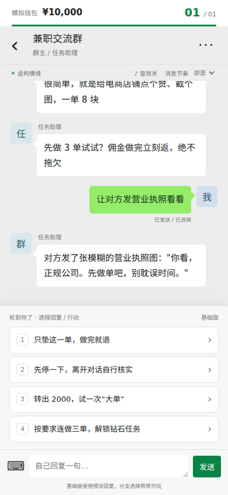

# 识局 · Unscam Lab 3.3

**从一条微信消息开始，练习自己的判断。**

基于 [QERSSD/HowToAvoidScams](https://github.com/QERSSD/HowToAvoidScams) 的原作聊天游戏改进。默认进入“别被骗了啊”：一万元模拟钱包、随机十二局、群聊 / 私聊 / 来电 / 短信 / 直播、回复选择和逐层加码。沿用原作的微信式表达，在同一套玩法里改善多端布局、消息节奏、关卡分支与复盘。



> 程序代码 MIT；教育文本及参考知识采用 CC BY-NC-SA 4.0。基础版不需要模型或 Key；AI 增强版在同一聊天中提供更多回复。整包教育内容不能直接用于商业用途。

## 3.3：把微信式聊天玩成一场互动游戏

- **一场完整的游戏体验**：全新聊天冒险开场、身份卡、新消息入场、十二格回合进度、对话归档和结算。16 个原作场景、12 局挑战、4 局热身和指定场景练习全部保留。
- **每次回复都有反馈**：气泡按方向进入，选项逐个展开，按钮有按压反馈；自然 / 快速 / 即显、正在输入和“立即看完”都可用。阅读旧消息时不会强制拉到底部。
- **像微信一样模拟转账**：明确显示收款角色、金额、余额及转出后余额。可以返回聊天再考虑；只有确认才执行原作行动。关闭弹窗、Esc、刷新不会扣钱，连续双击不会误触下一步。余额不足仍走原作借款分支。
- **可选择的游戏音效**：新消息、发送、入场、转账和结算有轻量音效，默认关闭，点击开启后才播放。无需音频下载、麦克风权限或外部服务。
- **有依据的行动徽章**：结算根据实际选择记录“独立核实”“及时刹车”“完成这一程”；迁移题答对后记录“举一反三”。不把这些徽章当成现实防骗能力评分。
- **键盘与多端**：数字键 1–4 可选择当前回复，输入文字时不会触发；手机贴屏、横屏紧凑、桌面固定聊天宽度，支持深色、大字和系统减少动态效果偏好。
- **续玩和 AI 保持完整**：入场与转账确认不写入虚构行动。合法行动可恢复，最近八次复盘进入统一备份；自由输入和 Key 不保存。AI 在同一微信聊天里回复，建议仍须点击确认；不接入 AI 也能完整游玩。

技术选择：原生 JavaScript + CSS，浏览器 [Web Animations API](https://developer.mozilla.org/en-US/docs/Web/API/Web_Animations_API/Using_the_Web_Animations_API) 处理消息动效，[Web Audio](https://developer.mozilla.org/en-US/docs/Web/API/AudioContext) 合成短音效。原作确定性引擎独立保留，呈现模块不改写资金或剧情规则；PWA 继续缓存基础玩法。线上由 Vinext / Sites Worker 承载可选模型网关。

| 开场 | 新消息入场 |
| --- | --- |
|  |  |

原作完整资料继续放在游戏“···”菜单与桌面导航。此前新增的 16 个分支练习保留在“扩展练习”，可独立使用。

<details>
<summary>手机端实景</summary>



</details>

## 完整收录的内容

本次不再只保留 373 篇摘要。以 QERSSD/HowToAvoidScams 的 `43c261f40c2e699f18bbcf3057645c0d8551ec23` 为固定快照，**完整保留全部 65 个仓库文件**，逐文件生成 SHA-256 与 Git blob 校验信息。2026-10-22 对照上游递归文件树，65 项均匹配。

| 内容 / 能力 | 本版实现与入口 |
| --- | --- |
| 学习地图 | “学习资料”连接自查、全文阅读、原作游戏与复习，显示阅读、自查及推理进度。 |
| 373 篇完整原文 | 保留所有原始字段和 8,248 个正文块；16 类、风险、人群、未读组合筛选；正文 / 编号搜索。 |
| 阅读器 | 独立文章链接、章节跳转、全文复制（含报道链接）、分享链接、打印、已读状态、收藏复习、明暗主题、大字模式。 |
| 45 项生活自查 | 8 组题目全部对应，提供行动版改写及可展开的原题原说明；已做到 / 待行动 / 暂不适用，按优先级生成可打印清单。 |
| 经典聊天闯关 | 原作“别被骗了啊”：16 个事件池、每局 12 轮、随机身份、专属回复、加码与结束复盘。原始事件和回复全部保留在 reference 快照，主游戏在其基础上修正表述与分支。 |
| 识骗迷局 | 原作 2 章 12 关、9×9 人物定位、线索和两级提示、破绽问答；增加键盘操作、统一备份，修复跨关撤回栈与提前标出主骗的问题。 |
| 完整知识资料 | 42 个术语、120 条报道、1,474 次文章关联、3 篇长文、16 个 Markdown 分卷、目录、核实记录、标注口径、原作者问答技能。 |
| 下载中心 | 原版 PDF、EPUB、Anki 卡包、单文件 HTML；含所有原始文件的 ZIP、逐文件校验清单、各份 Markdown 原文。 |
| 新版分支故事 | 保留 16 个原创情境（12 风险 + 4 正常业务）、5 类结局、逐步线索、挑战模式、完整复盘与迁移题。 |
| 可选 LLM | 基础模式完整可玩；开启 AI 后结合当前原作场景或扩展故事与最近 6 条对话回应；建议动作须由玩家确认。 |
| 复习与备份 | 风险回练、1 / 3 / 7 / 14 / 30 天知识卡复习；v1/v2 自动迁移；v3 备份含聊天闯关存档及最近八次复盘、全文已读、自查、推理结案与偏好。 |
| 多端与离线 | 320–1440px 响应式、键盘操作、PWA；首次缓存后，新版故事、全文、专题、自查、术语与经典游戏均可离线使用。大文件按需下载。 |

原文完整保留不等于事实逐条审核。原作标签、法律及医疗表述、游戏复盘均明确标注来源；本项目没有把上游绝对化法律结论用于新版训练判分。原始报道只保留索引与链接，不镜像第三方报道全文。

详细内容映射见 [完整覆盖清单](docs/CONTENT-COVERAGE.md)，版本变化见 [CHANGELOG.md](CHANGELOG.md)。

### 已部署站点

[打开识局](https://unscam-lab-live.terminalma1127.chatgpt.site)

Sites 版与本仓库 3.3 使用同一份知识、故事、自查及游戏内容，保留当前站点访问权限。游戏菜单或设置中可选择：

- **基础版**：不填 Key，完整使用学习和游戏功能。
- **AI 增强版**：在设置中选服务商、填写基础地址、模型与本次 Key；同意数据发送范围后启用。支持允许列表中的 OpenAI 兼容服务，提供 DeepSeek、OpenAI、阿里云百炼预设；自定义服务需维护者配置允许列表。

在线 Key 仅保存在页面内存，刷新或切回基础版即清空。仓库自托管版本使用下文的服务端环境变量接入方式；纯静态部署没有 AI 后端。

## 五分钟开始

要求 **Node.js 22 或更新版本**。生产运行不需要安装第三方依赖。

```bash
git clone https://github.com/xiaohuan-M/unscam-lab.git
cd unscam-lab
cp .env.example .env
npm start
```

打开 **http://127.0.0.1:3000**。没有 API Key 也能完成所有故事、复盘、搜索与复习。

首页点击“手机响了，开始 →”进入十二局，或先玩四局热身。每轮点“打开消息”（来电为“接听来电”）进入对话；音效按钮可随时开关。想专练一个情境，可以展开“练习一个指定场景”。需要资料和模型设置时，点击聊天右上角“···”。


## 接入 LLM

1. 在 `.env` 中配置服务与模型，重启应用：

```dotenv
LLM_BASE_URL=https://你的服务商/v1
LLM_MODEL=你的模型名
LLM_API_KEY=你的密钥
```

2. 进入“设置”，查看实际服务商和模型。
3. 可先“测试连接”（会调用一次模型，可能计费），再勾选启用 AI 并保存。
4. 返回“微信模拟”，在对话底部“自己回复一句”中自由追问。原作聊天每个场景每次打开页面最多 8 次 AI 追问，之后继续使用本地回复。

协议为 **OpenAI 兼容 `POST /chat/completions`**，服务须支持 `messages`、`max_tokens`、`temperature` 并能返回符合提示的 JSON。基础地址不包含 `/chat/completions`。本机模型可配置 `http://localhost:11434/v1` 等地址；非本机地址要求 HTTPS。兼容协议不代表每个模型都已实测。

如果不想把 Key 写在服务器，可留空 `LLM_API_KEY`，在设置页填临时 Key。Key、访问口令和 AI 开关仅存在当前页面内存中，刷新即清空；不会进入 localStorage 或导出备份。服务端配置的 Key 优先。

### AI 能做什么，不能做什么

- 能结合当前情境与最近 6 条对话回应，并提供新的核实性追问。
- 能把用户“我想回原 App 核实”等意图匹配到当前合法行动，玩家确认后执行。
- **不会自动扣款、改变分数或创建未经编写的新结局。** 这是有边界的互动剧情，并非无限生成世界。
- 模型失败、返回无效 JSON、超时或达到额度时，已有剧情仍能继续。
- 开启 AI 后，当前场景、最近对话和输入会发送到配置的服务商。请只讨论虚构情境，不输入真实账号、身份证、验证码等信息。

真实第三方付费模型需要部署者用自己的凭据验收；仓库测试使用模拟响应和本地 HTTP 兼容服务，不声称已经实测所有提供商。

## 部署方式

| 方式 | 基础玩法 | AI 对话 | 适用场景 |
| --- | --- | --- | --- |
| `npm start` | 是 | 可选 | 本机或服务器 |
| Docker | 是 | 可选 | 自托管服务器 |
| `npm run build` → `dist/` | 是 | 否 | 静态站点、GitHub Pages |

### 静态版

```bash
npm run build
```

将 **`dist/` 内全部文件**部署到静态站点。支持仓库子路径，无需打包器。静态版自动使用本地陪练。不能直接双击 `index.html` 使用，需要 HTTP(S) 服务。

仓库提供手动触发的 [Deploy static site](.github/workflows/pages.yml) 工作流。首次使用时，在仓库 Settings → Pages 将 Source 设为 GitHub Actions，再手动运行。此工作流会公开静态网站；推送代码不会自动发布站点。

### Docker / 公开 AI 服务

```bash
docker build -t unscam-lab:3.3.0 .
docker run --rm --name unscam-lab \
  -p 127.0.0.1:3000:3000 \
  --env-file .env -e HOST=0.0.0.0 -e APP_MODE=public \
  unscam-lab:3.3.0
```

通过 HTTPS 反向代理转发到该端口，并配置：

```dotenv
APP_MODE=public
APP_TOKEN=替换为至少16字符的随机口令
PUBLIC_ORIGIN=https://你的实际域名
LLM_DAILY_LIMIT=200
```

`APP_TOKEN` 只限制 AI 接口，基础页面仍可访问。即使后端绑定 localhost，只要通过反向代理公开，也必须设置 `APP_MODE=public`。公开模式没有合格口令时，AI 被禁用。

自带限制：每来源连接 IP 每分钟 20 次、同时最多 3 次模型调用、默认每服务器进程每 UTC 日 200 次。失败的提供商调用同样占预算。重启会重置内存计数，反向代理后的多个用户可能共用一个 IP；这些措施适合小规模实例，不能替代多实例计费与账号配额。更多说明见 [部署文档](docs/DEPLOYMENT.md)。

## 离线、升级与学习记录

- HTTPS 或 localhost 首次完整加载后，学习核心资源被缓存；断网可重新打开故事、373 篇全文、专题与分卷、自查、术语、报道索引和经典游戏。外部报道链接与 AI 仍需要联网。PDF / EPUB / Anki / 原版 HTML / ZIP 不预缓存，需提前下载。
- 发布更新后页面提示“新版已就绪”，点击更新会保存进度并加载新资源。
- `npm run build` 根据资源内容生成缓存版本，不需要手工修改版本号。
- 记录只保存在当前浏览器。跨设备使用“导出备份 / 导入备份”。
- v1 / v2 记录会自动迁移；备份导入保留较高成绩、较多谜题星级和较短结案时间。已有自查答案优先，已读记录合并；不会导入密钥或聊天。经典聊天按随机种子和合法行动重放恢复；最近八次结束记录一起备份，不包含自由输入。
- iOS 可通过 Safari 的分享菜单添加到主屏幕；实际安装行为依浏览器而异。

## 开发与验证

```bash
npm ci
npx playwright install chromium
npm run verify
```

`verify` 包含语法与剧情图校验、Node 测试、静态构建和 Chromium 浏览器测试。CI 另在 Node 22 / 24 上运行核心检查，并上传静态部署包和浏览器测试记录。

本版验收包含全部编写路径、余额和止损规则、正常情境、刷新续玩、错误备份、迁移判断、搜索复习、AI 上下文与失败恢复、离线完整故事，以及 320 / 390 / 768 / 1440 像素布局。详见 [QA.md](docs/QA.md)。移动端验收为 Chromium 窗口模拟，尚不等于 iOS / Android 真机验收。

```text
public/app.js              页面与交互
public/engine.js           可重放的确定性剧情引擎
public/lib/storage.js      迁移、校验、合并与备份
public/data/scenarios.json 剧情节点、线索、结局与迁移题
public/data/lessons.json   行动卡与公开来源
public/data/knowledge.json 上游全文与关联报道 ID
public/data/collection.json 资料索引与完整校验信息
public/lib/learning.js 学习中心、阅读器与自查
public/reference/      65 个完整原作文件（不格式化）
public/classic/        原作微信式界面、确定性规则和推理适配
content/classic-enhancements.json 16 场景的增量修订与迁移题
scripts/prepare-classic.mjs 原始数据 + 修订 → 可复现的运行数据
public/lib/classic-bridge.js 主页面与聊天之间的 AI / 进度桥接
public/downloads/      原项目完整 ZIP
server/llm.mjs             上下文、输出校验、合法行动映射
server/index.mjs           HTTP 服务、模型代理、访问和预算控制
scripts/build.mjs          静态产物与离线缓存版本
tests/                     单元、接口与浏览器测试
```

## 来源、许可与贡献

参考 [QERSSD/HowToAvoidScams](https://github.com/QERSSD/HowToAvoidScams)，不是其官方版本。保留上游 373 篇完整原文及全部项目内容和署名；未声称全部独立核验。六张行动卡另附公开来源与核对日期。故事均为虚构，不是实际案件还原；练习分不代表真实防骗能力。

- 程序代码：MIT。
- 教育文本与原作知识内容：CC BY-NC-SA 4.0。商业使用需取得授权或独立替换受限材料。
- [内容来源与编写规范](docs/CONTENT.md) · [贡献指南](CONTRIBUTING.md) · [隐私说明](docs/PRIVACY.md) · [安全边界](SECURITY.md)

当前不包含用户账号、云端同步、原生客户端、语音通话或未经审核的无限生成剧情。这些不影响本版本的完整基础学习流程。
